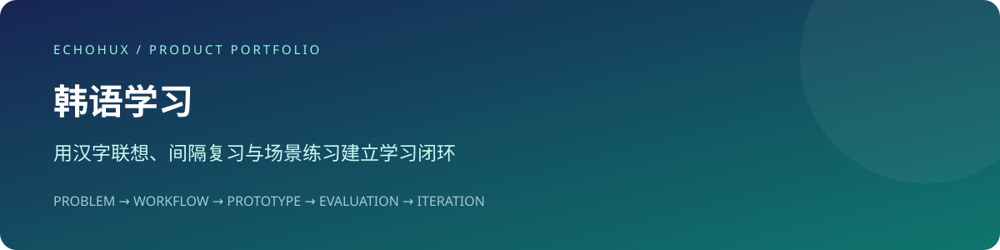

# 韩语学习 · Korean Vocabulary Study

> 用汉字联想、间隔复习与场景练习建立学习闭环。

  

**在线体验：** [打开产品](https://echohux.github.io/Korean-Vocabulary-Study/) · [验收与迭代记录](./docs/EVALUATION.md)



## 项目简介

面向中文母语学习者的韩语学习应用，把韩语词、罗马音、简体汉字与中文释义放入同一学习路径，并通过间隔复习、反向练习和学习统计持续反馈。

项目重点解决以下问题：

- 记忆关联不足：利用汉字联想连接新词和已有语言知识。
- 复习时机不清：根据自评结果安排到期复习。
- 学用脱节：增加中文回忆韩语、生活场景句与语音练习。

## 核心能力

- 单词卡、发音、答案揭示与“记住 / 没记住”自评。
- 基于 SM-2 的复习调度，“没记住”立即重新进入复习队列。
- 反向练习独立于正常复习计划。
- 酒店、帮助 / 医疗、旅游与餐厅等场景句。
- 内置例句和中文语法讲解；静态音频优先、系统 TTS 兜底。
- 学习进度、复习趋势与记忆曲线展示。

## 产品流程 · Pipeline

```text
选择学习范围 → 查看韩语 / 罗马音
    ↓
听发音 → 揭示汉字与中文释义
    ↓
自评：记住 / 没记住
    ↓
SRS 计算下次复习时间 → IndexedDB 保存
    ↓
到期复习 → 更新学习统计
    ↓
反向练习 / 场景句 → 强化回忆
```

核心学习与复习由本地内容和调度算法驱动。仓库提供可选模型讲解服务适配，不能将其描述为核心流程必须依赖的线上 Agent。

## 评测闭环

将核心任务、状态反馈与稳定性分开验收，再保留失败样例进行回归：

| 层级 | 验收关注点 |
| --- | --- |
| 结果质量 | 核心流程是否完成，输出或记录是否符合输入 |
| 过程质量 | 必要状态、异常反馈、数据一致性与可恢复性 |
| 稳定性 | 刷新与重复操作、依赖故障、存储或发布边界 |

```text
体验核心流程 → 记录实际结果 → 标注 Good / Bad / Boundary Case
      ↑                                      ↓
回归同一组用例 ← 修复并对比结果 ← 定位规则 / 数据 / 交互 / 依赖原因
```

这是本次补充的验收与迭代规范，尚未代表已经完成评测、建立自动化平台或取得量化成绩。项目专属用例与待填写记录见 [EVALUATION.md](./docs/EVALUATION.md)。

## 技术架构

- 学习页面：`src/pages/`；组件：`src/components/`。
- SRS：`src/services/srs.ts`，实现 SM-2 调度与到期判断。
- 存储：`src/services/db.ts`，IndexedDB 的 `reviews` 和 `explanations` 表。
- 内容：`src/data/`；朗读：`src/services/tts.ts` 与 `public/audio/ko/`。
- 可选讲解接口：`src/services/llm.ts`；模型配置在当前浏览器保存。

**技术栈：** React · TypeScript · Vite · Ant Design · IndexedDB。

## 本地运行

环境：Node.js 22+、pnpm 10+。

```bash
pnpm install --frozen-lockfile
pnpm dev
```

访问 `http://localhost:8080/Korean-Vocabulary-Study/`。

```bash
pnpm typecheck
pnpm lint
pnpm build
```

## 部署

`vite.config.ts` 已将资源基路径设为 `/Korean-Vocabulary-Study/`，构建结果在 `dist/`。部署到其他仓库名或域名时需调整 base。仓库现有 `dist/`，但未见自动部署 workflow；应在 Pages 设置中核对实际发布来源。

## 项目结构

```text
src/pages/               # 学习、复习、反向练习与统计
src/services/            # SRS、存储、朗读及可选模型
src/data/                # 单词、例句、场景与语法
public/audio/ko/         # 预生成韩语音频
scripts/                 # 内容与音频生成辅助脚本
dist/                    # 已提交的构建产物
```

## 产品取舍与边界

学习记录仅在当前浏览器，不会自动上传或跨设备同步；清理站点数据会丢失记录。内置例句不需要运行时模型调用，但页面和音频是否可离线访问取决于资源是否可用；没有据此承诺完整离线应用。不同系统的韩语 TTS 音色可能不同。

## 项目背景

项目通过 Vibe Coding 构建，产品关注点包括需求定义、任务流程、交互优先级与快速验证。本次说明文档参考 [FlowCraft AI](https://github.com/FILPPED-jin/FlowCraft-AI-Product) 的项目展示结构，按本仓库实际内容重新组织。
